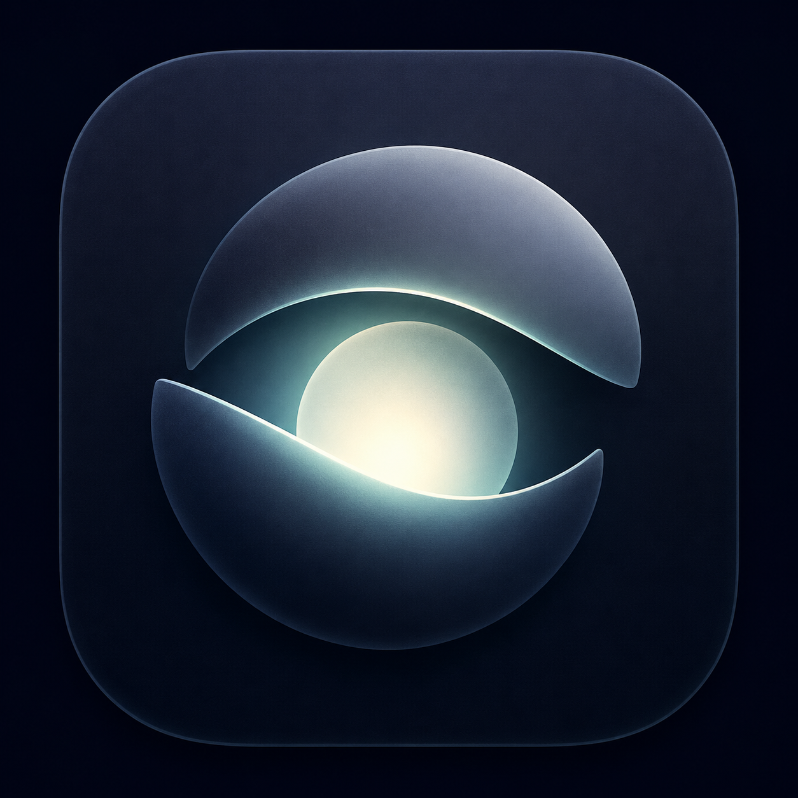

# LidBright

  

LidBright 是一个 macOS SwiftUI 应用，用于按 MacBook 开盖和合盖状态控制屏幕保持亮屏的策略。应用同时提供主窗口入口和菜单栏入口，设置会持久化到 `UserDefaults`。

## 业务规则

- 开盖后可选择跟随系统、永不熄屏、5 分钟、10 分钟、15 分钟、30 分钟或 60 分钟。
- 开盖定时模式只在当前开盖会话内保持亮屏，到期后回到跟随系统。
- 合盖后默认跟随系统。
- 合盖后可选择保持外接显示器亮屏；该模式要求检测到外接显示器并连接外接电源。

## 架构

项目是 Swift Package，最低平台为 macOS 14。

- `Sources/LidBrightApp`: macOS 应用层，包含 SwiftUI 场景、主窗口、菜单栏内容、系统环境读取和 IOKit 断言应用。
- `Sources/LidBrightCore`: 纯业务策略层，定义电源偏好、系统环境、策略状态和策略计算。
- `Sources/LidBrightCoreBehaviorTests`: 行为测试入口，覆盖核心策略分支和主窗口展示策略。
- `Sources/LidBrightApp/Resources`: 应用资源，包含应用图标。
- `script/build_and_run.sh`: 本地构建、打包、图标生成、安装包验证和启动脚本。

## 数据流

1. `LidBrightApp` 创建主窗口和菜单栏入口，并共享同一个 `AppModel` 实例。
2. `SettingsView` 和 `MenuBarContent` 修改 `AppModel` 中的开盖策略和合盖策略。
3. `AppModel` 将用户偏好写入 `UserDefaults`，并定期或在系统事件后重新应用策略。
4. `SystemEnvironmentProvider` 读取当前合盖状态、外接显示器状态和电源状态。
5. `PowerPolicy` 根据用户偏好和系统环境生成 `PowerPlan`。
6. `PowerAssertionClient` 根据 `PowerPlan` 创建或释放 IOKit power assertions。
7. `AppModel` 将策略状态和环境状态同步回主窗口和菜单栏。

## 策略边界

- `PowerPolicy` 不依赖 AppKit 或 IOKit，只负责纯策略计算。
- `PowerAssertionClient` 只根据策略结果管理 `kIOPMAssertPreventUserIdleDisplaySleep` 和 `kIOPMAssertPreventUserIdleSystemSleep`。
- 应用不修改系统 `pmset` 配置。
- 应用退出或系统进入睡眠前会释放已创建的 power assertions。

## 状态模型

核心状态由 `LidBrightCore` 定义：

- `OpenLidMode`: 开盖后的显示策略。
- `PowerPreferences`: 用户偏好。
- `PowerEnvironment`: 当前系统环境。
- `PowerPlan`: 需要应用的显示休眠断言、系统空闲休眠断言、定时到期时间和展示状态。
- `PowerStatus`: 当前策略状态，用于主窗口和菜单栏展示。

## 验证边界

`LidBrightCoreBehaviorTests` 直接验证 `PowerPolicy` 的主要业务分支：

- 开盖跟随系统。
- 开盖永不熄屏。
- 开盖定时熄屏。
- 合盖默认跟随系统。
- 合盖后外接显示器亮屏。
- 合盖后缺少外接电源或外接显示器时不创建断言。
- 应用主窗口入口保持普通 macOS 应用展示模式。
